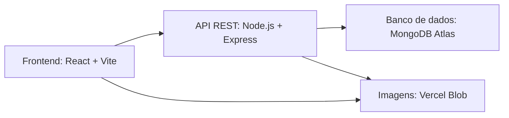

<div align="center">

<h1>Wired</h1>

<h3>Uma rede social de fotos com uma identidade visual suave, nostálgica e autoral.</h3>

<p>Projeto final do curso de <strong>Desenvolvimento Full Stack</strong>, criado do frontend ao banco de dados.</p>

<p>
  <strong><a href="https://mxliaf.github.io/wired-social/">Conheça o projeto online</a></strong>
  ·
  <strong><a href="https://github.com/mxliaf/wired-social">Veja o código</a></strong>
</p>

</div>

---

## ✦ Sobre o projeto

O **Wired** é uma rede social de fotos desenvolvida para transformar em prática tudo o que aprendi durante minha formação Full Stack.

Nela, cada pessoa pode criar sua conta, entrar na plataforma, compartilhar publicações e stories, conhecer outros usuários e personalizar o próprio perfil. A interface combina cores suaves, elementos delicados e referências nostálgicas à web, criando uma experiência simples, acolhedora e com personalidade.

O nome **Wired** foi inspirado no anime *Serial Experiments Lain*, em que a Wired representa uma rede digital que conecta pessoas, identidades e experiências. Essa referência também influenciou a atmosfera tecnológica e nostálgica escolhida para o projeto.

Mais do que reproduzir uma rede social, este projeto representa uma etapa importante da minha trajetória: foi nele que conectei **interface, API, armazenamento de imagens e banco de dados** em uma aplicação completa.

## ✦ Funcionalidades

| Funcionalidade | Descrição |
| --- | --- |
| 🔐 **Cadastro e login** | Criação de conta e acesso à plataforma com autenticação por token. |
| 📰 **Feed da comunidade** | Visualização das publicações dos usuários em ordem recente. |
| 📷 **Criar publicação** | Envio de imagem para o Vercel Blob e armazenamento da legenda no MongoDB. |
| ✏️ **Editar e excluir** | Atualização da legenda e remoção das próprias publicações. |
| ⏳ **Stories** | Publicação de imagens temporárias, visualização e indicação de stories já vistos. |
| 👤 **Perfis públicos** | Acesso ao perfil e às publicações de outras pessoas da comunidade. |
| 🎨 **Perfil personalizado** | Edição de nome, nome de usuário, bio, foto de perfil e imagem de capa. |
| ⚙️ **Configurações da conta** | Área protegida para consultar o e-mail e atualizar os dados do usuário. |
| 🌱 **Conteúdo inicial** | Criação automática de usuários e posts de demonstração quando o banco está vazio. |

## ✦ Arquitetura



O frontend consome a API REST, responsável pela autenticação, pelas regras da aplicação e pela comunicação com o MongoDB. As imagens são enviadas diretamente ao Vercel Blob após autorização da API, e o banco guarda apenas as URLs dos arquivos.

No deploy atual, o **GitHub Pages** publica o frontend e o **Vercel** hospeda a API. O MongoDB Atlas mantém os registros da aplicação e o Vercel Blob armazena fotos, capas, publicações e stories.

## ✦ Tecnologias

| Área | Tecnologias |
| --- | --- |
| **Frontend** | React 19, Vite, React Router, Bootstrap, JavaScript, HTML e CSS |
| **Backend** | Node.js, Express e API REST |
| **Banco de dados** | MongoDB Atlas e driver oficial do MongoDB |
| **Imagens** | Vercel Blob |
| **Autenticação e segurança** | Token assinado, hash de senhas, CORS e variáveis de ambiente |
| **Versionamento e deploy** | Git, GitHub Actions, GitHub Pages e Vercel |

## ✦ Como executar localmente

### Pré-requisitos

- Node.js 20.19 ou superior;
- npm;
- uma conexão com o MongoDB Atlas;
- um armazenamento público no Vercel Blob para utilizar os uploads.

### Instalação

```bash
git clone https://github.com/mxliaf/wired-social.git
cd wired-social
npm run setup
```

Crie o arquivo `backend/.env` a partir de `backend/.env.example` e informe:

```env
PORT=3000
FRONTEND_URL=http://localhost:5173
MONGODB_URI=sua_string_de_conexao
MONGODB_DB=wired
TOKEN_SECRET=seu_segredo
BLOB_READ_WRITE_TOKEN=seu_token_do_vercel_blob
```

Para usar outro endereço de API, crie também `frontend/.env` a partir de `frontend/.env.example`:

```env
VITE_API_URL=http://localhost:3000
```

Depois, inicie o frontend e o backend juntos:

```bash
npm run dev
```

- Frontend: `http://localhost:5173`
- API: `http://localhost:3000`

## ✦ Principais rotas da API

<details>
<summary><strong>Ver rotas</strong></summary>

### Autenticação e conta

| Método | Rota | Ação |
| --- | --- | --- |
| `POST` | `/api/auth/register` | Cadastra um usuário e retorna o token de acesso. |
| `POST` | `/api/auth/login` | Autentica o usuário e retorna o token de acesso. |
| `GET` | `/api/perfil` | Busca os dados da conta autenticada. |
| `PUT` | `/api/perfil` | Atualiza nome, usuário, bio, foto e capa. |
| `GET` | `/api/usuarios` | Lista os perfis da comunidade. |
| `GET` | `/api/usuarios/:id` | Busca um perfil público. |

### Publicações e uploads

| Método | Rota | Ação |
| --- | --- | --- |
| `POST` | `/api/uploads` | Autoriza o envio direto de uma imagem ao Vercel Blob. |
| `GET` | `/api/posts` | Lista as publicações ou filtra pelo usuário. |
| `POST` | `/api/posts` | Cria uma publicação com imagem e legenda. |
| `PUT` | `/api/posts/:id` | Edita a legenda de uma publicação própria. |
| `DELETE` | `/api/posts/:id` | Exclui uma publicação própria. |

### Stories

| Método | Rota | Ação |
| --- | --- | --- |
| `GET` | `/api/stories` | Lista os stories ainda disponíveis. |
| `POST` | `/api/stories` | Cria um story com duração de 24 horas. |
| `GET` | `/api/stories/:id` | Busca a imagem de um story disponível. |
| `PUT` | `/api/stories/:id/visto` | Marca o story como visualizado pelo usuário. |

</details>

## ✦ O que aprendi

- Organizar um projeto com frontend e backend separados;
- criar e consumir uma API REST;
- aplicar operações de CRUD em uma situação real;
- integrar a aplicação ao MongoDB Atlas;
- proteger senhas e rotas com autenticação por token;
- trabalhar com upload de imagens, armazenamento externo e variáveis de ambiente;
- publicar uma aplicação full stack e compreender o fluxo entre interface, servidor, arquivos e banco de dados.

## ✦ Próximos passos

- Mensagens diretas entre usuários;
- notificações de novas interações;
- sistema de seguidores e feed personalizado;
- busca e menu para explorar perfis e conteúdos;
- curtidas e comentários persistidos no banco;
- aba de vídeos curtos e publicações marcadas.

---

<div align="center">

Desenvolvido com curiosidade, criatividade e vontade de continuar aprendendo por **[Marilia](https://github.com/mxliaf)** ✦

</div>
